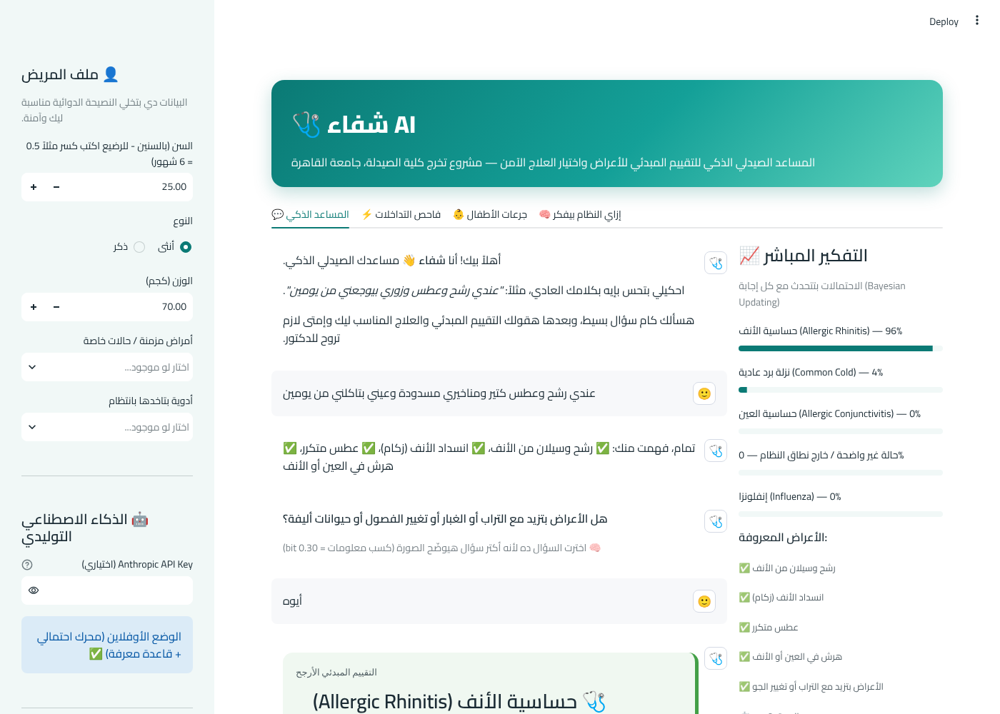
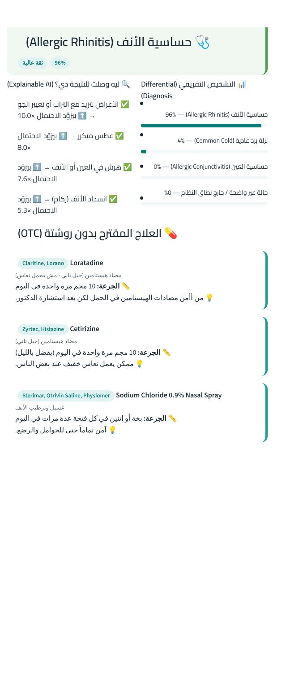
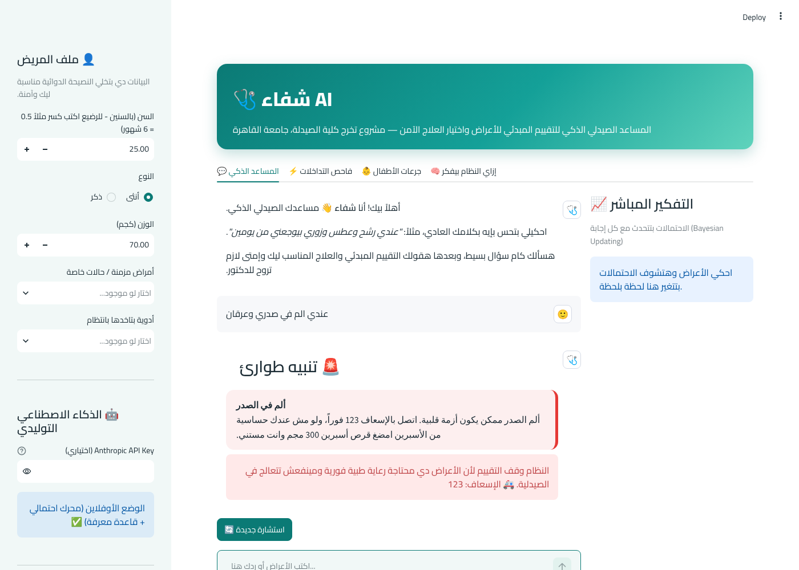
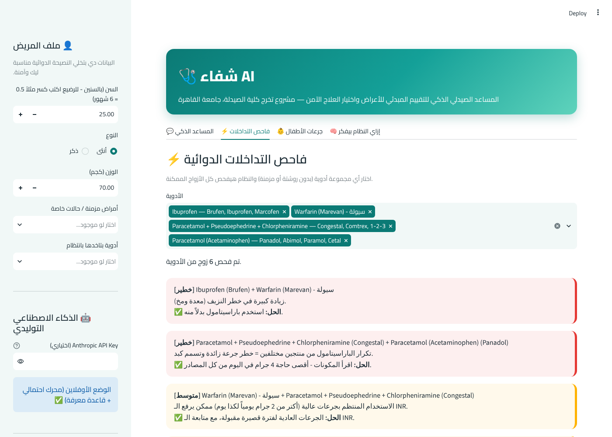
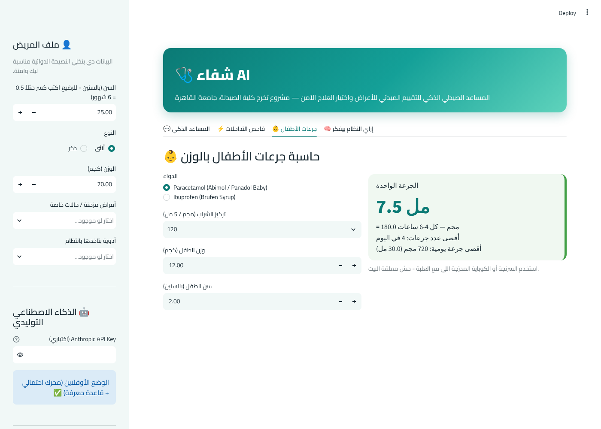
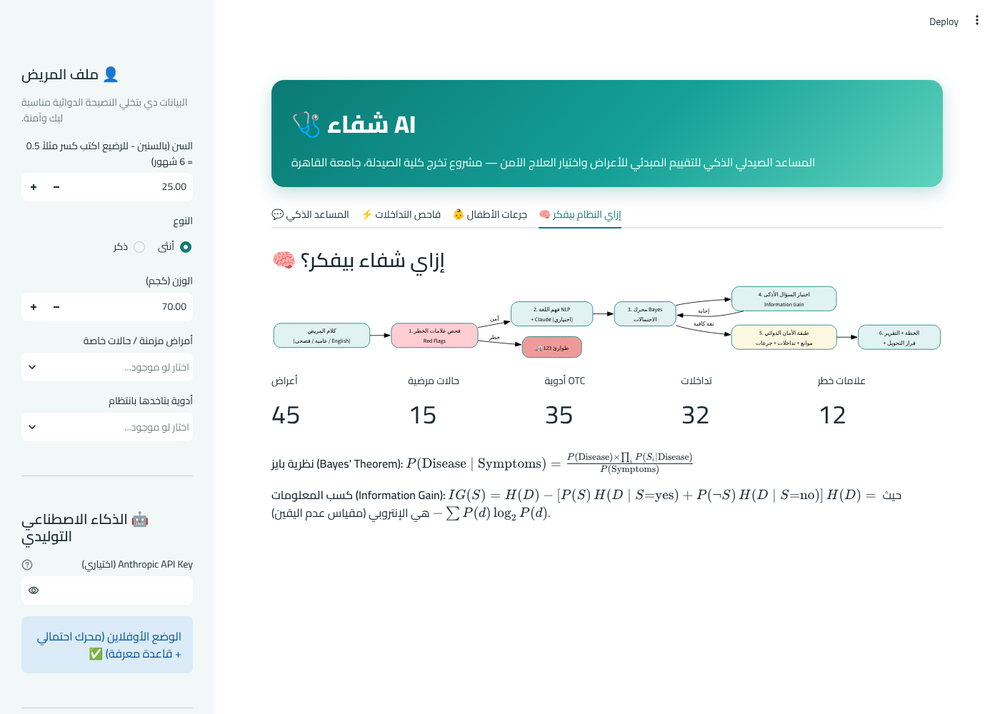

# شفاء AI
## نظام ذكي لدعم قرار الصيدلي في التقييم المبدئي للأعراض واختيار العلاج الآمن بدون وصفة طبية
### Shefa AI: An Explainable Hybrid AI Chatbot for Symptom Triage and Safe OTC Recommendation in Community Pharmacy

**مشروع تخرج — كلية الصيدلة، جامعة القاهرة**

إعداد: ............................................
إشراف: أ.د / ............................................
العام الجامعي: 2025 / 2026

---

## الفهرس

1. [الملخص (Abstract)](#الملخص)
2. [الفصل الأول: المقدمة وتحديد المشكلة](#الفصل-الأول-المقدمة-وتحديد-المشكلة)
3. [الفصل الثاني: أهداف المشروع](#الفصل-الثاني-أهداف-المشروع)
4. [الفصل الثالث: الخلفية الصيدلانية — دور الصيدلي في الاستجابة للأعراض](#الفصل-الثالث-الخلفية-الصيدلانية)
5. [الفصل الرابع: الخلفية في الذكاء الاصطناعي](#الفصل-الرابع-الخلفية-في-الذكاء-الاصطناعي)
6. [الفصل الخامس: تصميم النظام ومعماريته](#الفصل-الخامس-تصميم-النظام-ومعماريته)
7. [الفصل السادس: قاعدة المعرفة](#الفصل-السادس-قاعدة-المعرفة)
8. [الفصل السابع: محرك التشخيص الاحتمالي](#الفصل-السابع-محرك-التشخيص-الاحتمالي)
9. [الفصل الثامن: معالجة اللغة العربية](#الفصل-الثامن-معالجة-اللغة-العربية)
10. [الفصل التاسع: طبقة الأمان الدوائي](#الفصل-التاسع-طبقة-الأمان-الدوائي)
11. [الفصل العاشر: طبقة الذكاء الاصطناعي التوليدي](#الفصل-العاشر-طبقة-الذكاء-الاصطناعي-التوليدي)
12. [الفصل الحادي عشر: واجهة المستخدم](#الفصل-الحادي-عشر-واجهة-المستخدم)
13. [الفصل الثاني عشر: الاختبار والتقييم](#الفصل-الثاني-عشر-الاختبار-والتقييم)
14. [الفصل الثالث عشر: الاعتبارات الأخلاقية والقانونية](#الفصل-الثالث-عشر-الاعتبارات-الأخلاقية-والقانونية)
15. [الفصل الرابع عشر: القيود والتطوير المستقبلي](#الفصل-الرابع-عشر-القيود-والتطوير-المستقبلي)
16. [الخاتمة](#الخاتمة)
17. [المراجع](#المراجع)
18. [ملحق أ: سيناريو العرض أمام لجنة المناقشة](#ملحق-أ-سيناريو-العرض-أمام-لجنة-المناقشة)
19. [ملحق ب: الأسئلة المتوقعة من اللجنة وإجاباتها](#ملحق-ب-الأسئلة-المتوقعة-من-اللجنة-وإجاباتها)
20. [ملحق ج: قاموس المصطلحات](#ملحق-ج-قاموس-المصطلحات)

---

## الملخص

### بالعربية
تُعد الصيدلية المجتمعية في مصر نقطة الاتصال الأولى بين المريض والنظام الصحي، إذ يلجأ ملايين المرضى يومياً إلى الصيدلي لوصف أعراضهم وطلب العلاج دون زيارة الطبيب. ويواجه هذا النمط تحديات خطيرة، أبرزها: الاستخدام غير الرشيد للمضادات الحيوية، وصرف أدوية ممنوعة على فئات خاصة (الحوامل، ومرضى القرحة، ومرضى الضغط)، وإغفال التداخلات الدوائية مع الأدوية المزمنة، وتأخر تحويل الحالات الخطيرة إلى الطوارئ.

يقدم هذا المشروع نظام **"شفاء AI"**، وهو مساعد محادثة ذكي (Chatbot) يتحدث بالعامية المصرية، ويحاكي منهجية الصيدلي المحترف في الاستجابة للأعراض. يعتمد النظام على **معمارية هجينة (Hybrid Neuro-Symbolic Architecture)** تتكون من:
1. **طبقة كشف علامات الخطر (Red Flags)** تعمل قبل أي تحليل.
2. **محرك استدلال احتمالي قائم على نظرية بايز (Naive Bayes)** يحسب التشخيص التفريقي لخمس عشرة حالة بسيطة شائعة.
3. **خوارزمية لاختيار السؤال الأمثل** مبنية على مفهوم **كسب المعلومات (Information Gain)** من نظرية المعلومات لشانون.
4. **طبقة أمان دوائي** تفحص موانع الاستعمال وفق ملف المريض، والتداخلات الدوائية، وتحسب جرعات الأطفال بالوزن.
5. **طبقة اختيارية من نماذج اللغة الكبيرة (Claude)** لتحسين فهم اللغة الحرة وصياغة شرح ودود، مع ضوابط تمنعها من إضافة تشخيص أو دواء.

يتميز النظام بأنه **قابل للتفسير (Explainable AI)**؛ فهو يوضح للمستخدم سبب كل استنتاج، وسبب استبعاد كل دواء. وقد حقق النظام دقة 100% (14/14) في اختبار الحالات الإكلينيكية الافتراضية، واجتاز 24 اختباراً آلياً لوحدات النظام.

**الكلمات المفتاحية:** الصيدلة المجتمعية، الاستجابة للأعراض، الذكاء الاصطناعي القابل للتفسير، شبكات بايز، كسب المعلومات، التداخلات الدوائية، الأدوية بدون وصفة، روبوت المحادثة.

### In English
Community pharmacies are the first point of contact with healthcare for millions of Egyptians. This project presents **Shefa AI**, an Egyptian-Arabic conversational agent that emulates a pharmacist's structured approach to responding to symptoms. It combines a rule-based red-flag screener, a Naive Bayes diagnostic engine over 15 common minor ailments and 45 symptoms, an entropy-based next-question selector (Information Gain), and a pharmaceutical safety layer (patient-specific contraindications, 32 drug–drug interaction rules, weight-based pediatric dosing, and referral rules). An optional large language model layer (Anthropic Claude) improves free-text understanding and patient-friendly explanation under strict guardrails. The system is fully explainable and works offline. It achieved 14/14 accuracy on simulated clinical vignettes and passed 24 automated unit tests.

---

## الفصل الأول: المقدمة وتحديد المشكلة

### 1.1 الصيدلي كخط الدفاع الأول
في مصر، كما في كثير من الدول النامية، يتجه نسبة كبيرة من المرضى إلى الصيدلية مباشرة عند الشعور بأعراض بسيطة كنزلات البرد والإسهال والصداع، وذلك لأسباب عدة: سهولة الوصول (الصيدليات منتشرة ومفتوحة لساعات طويلة)، وانخفاض التكلفة مقارنة بالكشف، وثقة المجتمع في الصيدلي. هذا يجعل الصيدلي في موقع **"حارس البوابة" (Gatekeeper)** للنظام الصحي؛ فقراره إما أن يعالج الحالة البسيطة بأمان، أو يحوّل الحالة الخطيرة في الوقت المناسب.

### 1.2 المشكلات القائمة
1. **الصرف العشوائي للمضادات الحيوية:** كثير من حالات التهاب الحلق ونزلات البرد فيروسية، ومع ذلك يُطلب المضاد الحيوي ويُصرف، مما يساهم في أزمة **مقاومة المضادات الحيوية (Antimicrobial Resistance)** التي تعتبرها منظمة الصحة العالمية من أكبر التهديدات الصحية عالمياً.
2. **إغفال موانع الاستعمال:** مثل صرف مضادات الالتهاب غير الستيرويدية (NSAIDs) لمريض قرحة أو لحامل، أو صرف مزيلات الاحتقان الفموية (Pseudoephedrine) لمريض ضغط.
3. **إغفال التداخلات الدوائية:** مثل صرف Ibuprofen لمريض يأخذ Warfarin، مما يرفع خطر النزيف بشكل كبير.
4. **ازدواجية المادة الفعالة:** مثل تناول Panadol مع دواء برد مركب يحتوي أصلاً على باراسيتامول، مما قد يؤدي إلى تسمم الكبد.
5. **أخطاء جرعات الأطفال:** باستخدام ملعقة المنزل بدل السرنجة المدرجة، أو حساب الجرعة بالسن لا بالوزن.
6. **تأخر التعرف على الحالات الطارئة:** مثل ألم الصدر الذي يُعالج كحموضة، أو الصداع المفاجئ الشديد الذي يُعطى له مسكن.
7. **ضغط العمل:** في أوقات الذروة قد لا يجد الصيدلي الوقت الكافي لأخذ تاريخ مرضي منظم من كل مريض.

### 1.3 فكرة المشروع
تطوير أداة ذكية تعمل **كمساعد للصيدلي ولطالب الصيدلة وللمريض**، تجري مقابلة منظمة بالعامية المصرية، وتطبق منهجية علمية في التشخيص التفريقي، ثم تطبق "فلتر أمان دوائي" صارم قبل أي توصية علاجية، مع شرح كل قرار.

### 1.4 لماذا "شفاء"؟
اسم عربي بسيط يعبر عن الهدف، ويحمل طابعاً ثقافياً قريباً من المستخدم المصري، ويسهل تذكره.

---

## الفصل الثاني: أهداف المشروع

### 2.1 الهدف العام
بناء نظام ذكي قابل للتفسير يدعم قرار الصيدلي في التعامل مع الأعراض البسيطة الشائعة، ويرفع مستوى أمان الصرف بدون وصفة طبية.

### 2.2 الأهداف التفصيلية
1. فهم شكوى المريض المكتوبة بالعامية المصرية أو الفصحى أو الإنجليزية، بما في ذلك صيغ النفي.
2. اكتشاف علامات الخطر فوراً وتحويل المريض للطوارئ (123).
3. حساب التشخيص التفريقي بالاحتمالات، وتحديثه مع كل معلومة جديدة.
4. طرح أقل عدد ممكن من الأسئلة الذكية للوصول إلى تشخيص بثقة عالية.
5. اقتراح علاج OTC مناسب بالأسماء التجارية المتوفرة في السوق المصري، مع الجرعة.
6. استبعاد الأدوية الممنوعة على المريض مع **ذكر السبب**.
7. فحص التداخلات الدوائية مع الأدوية المزمنة وكشف ازدواجية المادة الفعالة.
8. حساب جرعات الأطفال بالوزن وتحويلها إلى مللي من الشراب.
9. تحديد متى يجب التحويل للطبيب.
10. توليد تقرير قابل للطباعة.
11. العمل دون إنترنت، مع إمكانية الاستفادة من نماذج اللغة الكبيرة عند توفرها.

---

## الفصل الثالث: الخلفية الصيدلانية

### 3.1 مفهوم "الاستجابة للأعراض" (Responding to Symptoms)
هو أحد المهارات الأساسية للصيدلي المجتمعي، ويعني قدرة الصيدلي على: جمع المعلومات من المريض، والتمييز بين الحالة البسيطة التي يمكن علاجها في الصيدلية (Minor Ailment) والحالة التي تستوجب التحويل، ثم اختيار العلاج المناسب والآمن، وتقديم النصيحة.

### 3.2 بروتوكولات أخذ التاريخ المرضي
اعتمد تصميم المحادثة في "شفاء" على البروتوكولات المعتمدة عالمياً في الصيدلة المجتمعية:

**بروتوكول WWHAM:**
| الحرف | المعنى | كيف طبقه النظام |
|---|---|---|
| **W** | Who is the patient? (من المريض؟) | ملف المريض في الشريط الجانبي: السن، النوع، الوزن، الحمل |
| **W** | What are the symptoms? (ما الأعراض؟) | المحادثة الحرة + استخراج الأعراض + الأسئلة الذكية |
| **H** | How long? (منذ متى؟) | سؤال المدة الإجباري + استخراجها تلقائياً من الكلام |
| **A** | Action taken? (ماذا فعلت؟) | الأدوية الحالية في ملف المريض |
| **M** | Medication? (أدوية أخرى؟) | الأدوية المزمنة لفحص التداخلات |

**بروتوكول ASMETHOD** (أكثر تفصيلاً): Age/appearance, Self or someone else, Medication, Extra medicines, Time persisting, History, Other symptoms, Danger symptoms. وقد غطى النظام عناصره كلها، خاصة **Danger symptoms** التي جعلناها أول خطوة في المعالجة.

### 3.3 علامات الخطر (Red Flags)
هي أعراض أو علامات تدل على احتمال وجود مرض خطير، وتستوجب التحويل الفوري. اعتمد النظام 12 مجموعة من علامات الخطر:

| علامة الخطر | الاحتمال الخطير | الإجراء |
|---|---|---|
| ألم في الصدر | احتشاء عضلة القلب (MI) | إسعاف 123 + مضغ أسبرين 300 مجم إن لم يكن هناك حساسية |
| ضيق شديد في التنفس | أزمة ربو حادة، انسداد رئوي، فشل قلبي | إسعاف |
| ميل الوجه، ضعف نصف الجسم، صعوبة الكلام | السكتة الدماغية (FAST) | إسعاف فوراً وتسجيل وقت البداية |
| صداع مفاجئ "أسوأ صداع في حياتي" | نزيف تحت العنكبوتية (SAH) | طوارئ |
| تيبس الرقبة مع حرارة | الالتهاب السحائي | طوارئ |
| ترجيع دم، براز أسود، كحة بدم | نزيف هضمي أو رئوي | طوارئ |
| إغماء، تشنجات، تشوش | أسباب عصبية أو أيضية | إسعاف |
| ألم بطن شديد | الزائدة الدودية، البطن الحاد | طوارئ دون مسكنات |
| علامات جفاف شديد | فقدان سوائل خطير | محاليل وريدية |
| تورم الوجه والشفايف | صدمة الحساسية (Anaphylaxis) | إسعاف + EpiPen |
| نزيف أثناء الحمل | إجهاض، حمل خارج الرحم | طوارئ نساء |
| أفكار إيذاء النفس | خطر انتحار | الخط الساخن للصحة النفسية |

> **قرار تصميمي مهم:** علامات الخطر تُفحص **قبل** أي حساب احتمالي، وفي **كل** رسالة يكتبها المريض، لأن تكلفة "السلبية الكاذبة" (False Negative) هنا قد تكون حياة إنسان. هذا يتبع مبدأ **"السلامة أولاً" (Safety-first design)**.

### 3.4 الحالات البسيطة التي يغطيها النظام
اختيرت 15 حالة من أكثر الحالات التي تقابل الصيدلي يومياً:

| المجموعة | الحالات |
|---|---|
| الجهاز التنفسي | نزلة البرد، الإنفلونزا، حساسية الأنف، التهاب الحلق، الكحة الحادة |
| الجهاز الهضمي | النزلة المعوية، الإمساك، الحموضة والارتجاع |
| الجهاز العصبي | الصداع التوتري، الصداع النصفي |
| الجهاز البولي والتناسلي | التهاب المثانة البسيط، ألم الدورة الشهرية |
| الجلد | الفطريات الجلدية (Tinea) |
| العين | حساسية العين، التهاب الملتحمة البكتيري |

بالإضافة إلى فئة سادسة عشرة اصطناعية هي **"حالة غير واضحة / خارج نطاق النظام"**، وسنشرح أهميتها في الفصل السابع.

### 3.5 تصنيف الأدوية بدون وصفة
اعتمد النظام 35 دواء ومستحضراً متاحاً في السوق المصري دون وصفة، مع ذكر الاسم العلمي والأسماء التجارية الشائعة، والجرعات للكبار والأطفال، وأقل سن مسموح، والحالات المانعة، والحالات التي تستوجب الحذر. وقد أُدرجت أدوية محدودة (مثل Omeprazole وFamotidine) بقيود مدة الاستخدام الذاتي (14 يوماً) كما في الإرشادات العالمية.

---

## الفصل الرابع: الخلفية في الذكاء الاصطناعي

### 4.1 النظم الخبيرة (Expert Systems)
النظام الخبير برنامج يحاكي قرار الخبير البشري في مجال محدد، ويتكون من **قاعدة معرفة (Knowledge Base)** و**محرك استدلال (Inference Engine)**. من أشهر الأمثلة التاريخية نظام **MYCIN** (جامعة ستانفورد، السبعينيات) الذي شخّص العدوى البكتيرية واقترح المضاد الحيوي، وكانت دقته مقاربة لدقة الأطباء المتخصصين. "شفاء" ينتمي لهذه العائلة، لكنه يستخدم الاحتمالات بدلاً من القواعد الصارمة.

### 4.2 الاستدلال الاحتمالي ونظرية بايز
الطب علم احتمالي بطبيعته؛ فلا يوجد عرض واحد يؤكد مرضاً بنسبة 100%. نظرية بايز (Thomas Bayes، القرن الثامن عشر) تعطينا طريقة رياضية لتحديث اعتقادنا عند ظهور دليل جديد:

$$P(D \mid S) = \frac{P(S \mid D) \cdot P(D)}{P(S)}$$

- $P(D)$ **الاحتمال المبدئي (Prior):** مدى انتشار المرض قبل أن نعرف أي شيء عن المريض.
- $P(S \mid D)$ **الأرجحية (Likelihood):** احتمال ظهور العرض لو كان المريض مصاباً بالمرض. (وهي قريبة من مفهوم الحساسية Sensitivity).
- $P(D \mid S)$ **الاحتمال البعدي (Posterior):** احتمال المرض بعد معرفة العرض.

هذا بالضبط ما يفعله الطبيب الماهر ذهنياً: يبدأ بالأمراض الشائعة، ويعدّل تقديره مع كل معلومة.

### 4.3 مصنف بايز الساذج (Naive Bayes)
عند وجود أكثر من عرض، نفترض أن الأعراض **مستقلة شرطياً** بمعلومية المرض، فيصبح:

$$P(D \mid S_1, ..., S_n) \propto P(D) \prod_{i=1}^{n} P(S_i \mid D)$$

سُمي "ساذجاً" لأن افتراض الاستقلال غير دقيق تماماً في الواقع (مثلاً الحرارة والرعشة مرتبطتان)، لكنه أثبت كفاءة عملية عالية في التشخيص الطبي وتصنيف النصوص، ويتميز بالبساطة والسرعة وقابلية التفسير.

### 4.4 نظرية المعلومات والإنتروبي
وضع **كلود شانون** عام 1948 مفهوم **الإنتروبي (Entropy)** لقياس "عدم اليقين":

$$H(D) = -\sum_{d} P(d) \log_2 P(d)$$

- لو كل الأمراض متساوية الاحتمال: الإنتروبي أعلى ما يمكن (أقصى حيرة).
- لو مرض واحد احتماله 100%: الإنتروبي = صفر (يقين كامل).

ووحدة القياس هي **البت (bit)**: كل بت يعادل سؤال "نعم/لا" مثالي يقسم الاحتمالات للنصف.

### 4.5 نماذج اللغة الكبيرة (LLMs)
نماذج مثل Claude وGPT تُدرَّب على كميات هائلة من النصوص، وتتميز بفهم اللغة الطبيعية بمرونة عالية. لكن لها عيوب خطيرة في المجال الطبي:
- **الهلوسة (Hallucination):** قد تخترع معلومة أو جرعة غير صحيحة بثقة.
- **عدم القابلية للتفسير:** صعب معرفة لماذا أعطت إجابة معينة.
- **عدم الثبات:** قد تعطي إجابات مختلفة لنفس السؤال.

### 4.6 لماذا معمارية هجينة؟ (Neuro-Symbolic AI)
لذلك اخترنا في "شفاء" **معمارية هجينة**: القرارات الطبية الحرجة (التشخيص، الأدوية، الجرعات، التداخلات، التحويل) تتخذها **مكونات رمزية (Symbolic) شفافة وقابلة للمراجعة**، بينما يُستخدم النموذج اللغوي فقط فيما يتقنه: **فهم اللغة وصياغة الكلام**. هذا يجمع مرونة الذكاء الاصطناعي الحديث مع أمان وموثوقية النظم الخبيرة.

### 4.7 الذكاء الاصطناعي القابل للتفسير (Explainable AI - XAI)
في المجال الطبي لا يكفي أن يكون النظام دقيقاً؛ يجب أن يكون **مفهوماً**. فالصيدلي والمريض من حقهما معرفة لماذا اقترح النظام هذا التشخيص أو استبعد هذا الدواء. "شفاء" يقدم ثلاثة مستويات من التفسير:
1. **نسبة الأرجحية لكل عرض:** "العطس زوّد احتمال الحساسية 8 أضعاف".
2. **سبب استبعاد كل دواء:** "Brufen ممنوع مع: قرحة المعدة".
3. **سبب اختيار كل سؤال:** "اخترت السؤال ده لأنه هيضيف 0.37 bit من المعلومات".

---

## الفصل الخامس: تصميم النظام ومعماريته

### 5.1 المعمارية العامة

```
                ┌───────────────────────────────┐
                │   كلام المريض (عامية/فصحى/EN)   │
                └───────────────┬───────────────┘
                                ▼
                ┌───────────────────────────────┐   خطر   ┌──────────────┐
                │ 1. كاشف علامات الخطر Red Flags │───────►│ 🚑 طوارئ 123  │
                └───────────────┬───────────────┘        └──────────────┘
                                ▼ آمن
                ┌───────────────────────────────┐
                │ 2. فهم اللغة NLP (+ Claude)     │
                │  أعراض موجودة/منفية + المدة     │
                └───────────────┬───────────────┘
                                ▼
                ┌───────────────────────────────┐ ◄── إجابة المريض
                │ 3. محرك Bayes للاحتمالات        │          │
                └───────────────┬───────────────┘          │
                   ثقة < 80%    │                          │
                                ▼                          │
                ┌───────────────────────────────┐          │
                │ 4. اختيار السؤال (Info Gain)    │──────────┘
                └───────────────────────────────┘
                   ثقة ≥ 80% أو 7 أسئلة
                                ▼
                ┌───────────────────────────────┐
                │ 5. طبقة الأمان الدوائي           │
                │ موانع + تداخلات + سن + جرعات    │
                └───────────────┬───────────────┘
                                ▼
                ┌───────────────────────────────┐
                │ 6. الخطة + التحويل + التقرير     │
                │   (+ شرح ودود من Claude)        │
                └───────────────────────────────┘
```

### 5.2 مكونات البرنامج (Modules)

| الملف | المسؤولية |
|---|---|
| `engine/knowledge_base.py` | قاعدة المعرفة: 45 عرضاً، 15 حالة، 35 دواء، 14 دواء مزمن، 32 تداخلاً، 12 علامة خطر |
| `engine/nlp.py` | توحيد النص العربي، استخراج الأعراض، كشف النفي، استخراج الحرارة والمدة، كشف علامات الخطر |
| `engine/diagnosis.py` | تعديل الاحتمالات المبدئية حسب المريض، حساب الاحتمال البعدي، الإنتروبي، كسب المعلومات، التفسير |
| `engine/safety.py` | فلترة الأدوية، فحص التداخلات، قواعد التحويل، حاسبة جرعات الأطفال |
| `engine/ai_assistant.py` | التكامل الاختياري مع Claude |
| `engine/report.py` | توليد تقرير HTML للمريض |
| `app.py` | واجهة المستخدم بمكتبة Streamlit وإدارة حالة المحادثة |
| `tests/test_engine.py` | الاختبارات الآلية |

### 5.3 آلة الحالات للمحادثة (Conversation State Machine)
المحادثة ليست عشوائية، بل تمر بمراحل محددة:

```
 start ──(أعراض)──► duration ──(المدة)──► questions ◄──┐
   │                                          │   (إجابة)│
   │ (علامة خطر في أي مرحلة)                    ├─────────┘
   ▼                                          ▼ (ثقة كافية)
emergency                                    done
```
- **start:** المريض يكتب شكواه.
- **duration:** إذا لم يذكر المدة، يُسأل عنها (عنصر H في WWHAM).
- **questions:** أسئلة نعم/لا يختارها النظام بذكاء.
- **done:** عرض النتيجة.
- **emergency:** توقف فوري عند أي علامة خطر.

### 5.4 التقنيات المستخدمة
- **لغة Python:** الأكثر استخداماً في الذكاء الاصطناعي، وسهلة القراءة.
- **مكتبة Streamlit:** لبناء واجهة ويب تفاعلية بلغة Python فقط دون الحاجة لـ HTML/JavaScript.
- **Anthropic SDK:** للاتصال الاختياري بنموذج Claude.
- **unittest:** لاختبار الكود.

لم يُستخدم أي مكتبة تعلم آلي جاهزة في المحرك الأساسي؛ **كل المعادلات مكتوبة يدوياً** لإثبات الفهم الكامل لها وقابليتها للشرح.

---

## الفصل السادس: قاعدة المعرفة

### 6.1 بنية العرض (Symptom)
```python
"sneezing": {
    "name": "عطس متكرر",
    "question": "هل بتعطس كتير؟",
    "synonyms": ["عطس", "بعطس", "عطاس", "sneeze", "sneezing"],
}
```
لكل عرض: اسم يظهر للمستخدم، وسؤال متابعة بالعامية، وقائمة مرادفات (عامية، فصحى، إنجليزي) يتعرف بها النظام على العرض في الكلام.

### 6.2 بنية الحالة المرضية (Condition)
```python
"allergic_rhinitis": {
    "name": "حساسية الأنف (Allergic Rhinitis)",
    "prior": 0.09,
    "max_days": 30,
    "likelihoods": {"sneezing": 0.90, "itchy_eyes_nose": 0.85, "fever": 0.02, ...},
    "advice": [...],
    "drugs": ["loratadine", "cetirizine", "saline_spray", "ketotifen_eye"],
    "refer_if": [...],
}
```
- **prior:** الانتشار النسبي للحالة بين مرتادي الصيدلية.
- **likelihoods:** احتمال وجود كل عرض مع هذه الحالة.
- **max_days:** المدة الطبيعية المتوقعة؛ إذا زادت يجب التحويل.
- **drugs:** الأدوية المرشحة (قبل فلتر الأمان).
- **advice / refer_if:** نصائح غير دوائية ومعايير التحويل.

### 6.3 مصدر الأرقام
تم تقدير الأرجحيات بناءً على الوصف الإكلينيكي في المراجع الصيدلانية المعتمدة (Blenkinsopp – Symptoms in the Pharmacy، Rutter – Community Pharmacy، وNICE CKS). على سبيل المثال: الحرارة العالية المفاجئة سمة مميزة للإنفلونزا (0.70) ونادرة في نزلة البرد العادية (0.03)، بينما الهرش في العين والأنف سمة مميزة للحساسية (0.85).

> **ملاحظة أمانة علمية:** هذه الأرقام تقديرات خبيرة لأغراض تعليمية وليست مشتقة من دراسة وبائية مصرية. وجزء من التطوير المستقبلي هو معايرتها ببيانات حقيقية (انظر الفصل الرابع عشر).

### 6.4 احتمال التسرب (Leak Probability)
إذا لم يُذكر عرض ما ضمن أعراض حالة معينة، فلا نعطيه احتمال صفر، بل 0.02. لماذا؟ لأن الصفر في عملية الضرب "يقتل" الحالة نهائياً؛ فلو ذكر مريض نزلة برد عرضاً عابراً غير معتاد، لا نريد أن يُستبعد التشخيص الصحيح تماماً. هذه تقنية معروفة في شبكات بايز الطبية باسم **Leaky Noisy-OR**، وتشبه **Laplace smoothing** في تعلم الآلة.

### 6.5 بنية الدواء
```python
"ibuprofen": {
    "generic": "Ibuprofen", "brands": "Brufen, Ibuprofen, Marcofen",
    "group": "nsaid",
    "adult_dose": "200 - 400 مجم كل 6-8 ساعات بعد الأكل، بحد أقصى 1200 مجم...",
    "child_dose": "10 مجم/كجم كل 6-8 ساعات بعد الأكل (من سن 6 شهور)",
    "min_age": 0.5,
    "avoid_if": ["peptic_ulcer", "kidney", "pregnancy", "nsaid_allergy", "heart_disease"],
    "caution_if": ["asthma", "hypertension", "breastfeeding", "liver"],
}
```
**المجموعة الدوائية (group)** هي مفتاح فحص التداخلات؛ فبدل كتابة تداخل لكل دواء على حدة، نكتب التداخل بين المجموعات (مثلاً `nsaid` + `anticoagulant`)، فيُطبق تلقائياً على Ibuprofen وMefenamic acid وأي NSAID يضاف مستقبلاً. والأدوية المركبة (مثل Congestal) لها أكثر من مجموعة (`also: ["paracetamol"]`).

### 6.6 إحصائيات قاعدة المعرفة
| العنصر | العدد |
|---|---|
| الأعراض | 45 |
| الحالات المرضية | 15 (+ فئة غير معروفة) |
| أدوية OTC | 35 |
| الأدوية المزمنة | 14 |
| قواعد التداخل | 32 |
| علامات الخطر | 12 |
| حالات المريض الخاصة | 12 |

---

## الفصل السابع: محرك التشخيص الاحتمالي

### 7.1 تعديل الاحتمالات المبدئية حسب المريض
قبل أي حساب، تُعدَّل الاحتمالات المبدئية حسب بيانات المريض، تماماً كما يفعل الصيدلي:
- **الذكور، ومن هم أقل من 10 أو أكبر من 55 سنة:** احتمال ألم الدورة = صفر.
- **الإناث:** احتمال التهاب المثانة × 2.5 (لقصر مجرى البول).
- **الأطفال أقل من 12 سنة:** النزلات المعوية × 1.5، والارتجاع × 0.3.
- **كبار السن فوق 60:** الإمساك × 1.5، والفئة "غير المعروفة" × 2 (لأن الأعراض عند كبار السن أقل نمطية، مما يرفع حذر النظام).

### 7.2 حساب الاحتمال البعدي
لكل حالة $D$:

$$\text{Score}(D) = \log P(D) + \sum_{S \in \text{present}} \log P(S \mid D) + \sum_{S \in \text{absent}} \log\big(1 - P(S \mid D)\big)$$

**ملاحظات:**
1. **الأعراض المنفية لها قيمة:** إذا قال المريض "مفيش حرارة"، فهذا يقلل احتمال الإنفلونزا (لأن $1 - 0.90 = 0.10$) بينما بالكاد يؤثر على حساسية الأنف ($1 - 0.02 = 0.98$). هذا ما يسميه الأطباء **"Pertinent negatives"**.
2. **إجابة "مش متأكد"** لا تدخل في الحساب إطلاقاً (لا تضيف معلومة).
3. **لماذا اللوغاريتم؟** حاصل ضرب عشرات الأرقام الصغيرة (مثل 0.02) يصبح رقماً ضئيلاً جداً قد يقربه الكمبيوتر إلى صفر (**Numerical Underflow**). اللوغاريتم يحوّل الضرب إلى جمع ويحل المشكلة.
4. **التطبيع (Normalization):** نحول الدرجات إلى احتمالات مجموعها 100% بدالة **Softmax** مع طرح القيمة العظمى أولاً (Log-Sum-Exp trick) لضمان الثبات العددي.

### 7.3 مثال محلول بالأرقام (من النظام نفسه)
**المريضة:** أنثى، 25 سنة. كتبت: *"عندي رشح وعطس ومناخيري مسدودة"*.
الأعراض المستخرجة: رشح ✅، عطس ✅، انسداد ✅.

| الحالة | Prior | P(رشح) | P(عطس) | P(انسداد) | الحاصل |
|---|---|---|---|---|---|
| نزلة برد | 0.16 | 0.90 | 0.75 | 0.85 | 0.16 × 0.90 × 0.75 × 0.85 = **0.0918** |
| حساسية الأنف | 0.09 | 0.85 | 0.90 | 0.70 | 0.09 × 0.85 × 0.90 × 0.70 = **0.0482** |
| إنفلونزا | 0.09 | 0.40 | 0.15 | 0.35 | **0.0019** |
| غير معروفة | 0.04 | 0.12 | 0.12 | 0.12 | **0.00007** |

المجموع ≈ 0.1423 (مع إسهامات ضئيلة من باقي الحالات)، إذن:
- نزلة برد = 0.0918 ÷ 0.1423 ≈ **64.5%**
- حساسية الأنف = 0.0482 ÷ 0.1423 ≈ **33.9%**
- إنفلونزا ≈ **1.3%**

الثقة 64.5% أقل من الحد المطلوب (80%)، إذن يجب أن يسأل النظام سؤالاً. لكن أي سؤال؟

### 7.4 اختيار السؤال الأمثل بكسب المعلومات
الإنتروبي الحالية: $H = 1.047$ bit.

لكل عرض لم نسأل عنه، يحسب النظام: لو أجابت المريضة بنعم، كم ستصبح الإنتروبي؟ ولو أجابت بلا؟ ثم يأخذ المتوسط المرجح باحتمال كل إجابة:

$$IG(S) = H(D) - \Big[P(S{=}\text{yes}) \cdot H(D \mid S{=}\text{yes}) + P(S{=}\text{no}) \cdot H(D \mid S{=}\text{no})\Big]$$

حيث $P(S{=}\text{yes}) = \sum_d P(d) \cdot P(S \mid d)$.

النتائج الفعلية من النظام:

| السؤال المرشح | كسب المعلومات (bit) |
|---|---|
| **هل الأعراض بتزيد مع التراب أو تغيير الجو؟** | **0.371** ⭐ |
| هل عينك أو مناخيرك بتاكلك؟ | 0.359 |
| هل زورك بيوجعك؟ | 0.144 |
| هل عندك سخونية؟ | 0.084 |

اختار النظام سؤال "التراب وتغيير الجو" لأنه **الأكثر تمييزاً** بين نزلة البرد (0.10) والحساسية (0.80). لاحظ أن سؤال الحرارة، رغم أنه سؤال "طبيعي" يسأله أي شخص، معلوماته قليلة هنا لأن الحرارة نادرة في الحالتين المتنافستين.

**بعد الإجابة:**
- لو "أيوه": حساسية الأنف **80.5%** ← توقف النظام (وصل لحد الثقة) وعرض علاج الحساسية.
- لو "لأ": نزلة البرد **87.5%** ← توقف وعرض علاج البرد.

**سؤال واحد ذكي حسم التشخيص.** هذا هو جوهر الإبداع في المشروع: النظام لا يسأل قائمة ثابتة من الأسئلة، بل يفكر مثل الخبير ويختار السؤال الذي يفرق بين الاحتمالات المتنافسة.

### 7.5 شروط التوقف
يتوقف النظام عن الأسئلة عند تحقق أي من:
1. أعلى احتمال ≥ **80%** (ثقة كافية).
2. عدد الأسئلة وصل إلى **7** (احترام وقت المريض).
3. أفضل سؤال متاح كسبه < **0.03 bit** (لا توجد أسئلة مفيدة).

ولتقليل عدد الأسئلة غير المنطقية، يقتصر البحث على الأعراض المرتبطة بأعلى 5 حالات احتمالاً.

### 7.6 فئة "حالة غير واضحة" (Open-World Assumption)
مشكلة أي مصنف هي أنه **مجبر** على اختيار إجابة من القائمة، حتى لو كان المريض مصاباً بمرض غير موجود فيها (Closed-World Assumption). لحل ذلك أضفنا فئة اصطناعية تعطي كل الأعراض احتمالاً متوسطاً ثابتاً (0.12). إذا كانت الأعراض غير متسقة مع أي حالة معروفة، تفوز هذه الفئة، فيوصي النظام بزيارة الطبيب بدلاً من تخمين خاطئ. وكذلك إذا كانت أعلى ثقة أقل من 55%، يضيف النظام توصية بالتقييم الطبي.

### 7.7 التفسير (Explainability) بنسبة الأرجحية
لكل عرض، نحسب **نسبة الأرجحية (Likelihood Ratio)**:

$$LR = \frac{P(S \mid D_{\text{top}})}{\overline{P(S \mid D_{\text{others}})}}$$

ونعرض الأعراض الأكثر تأثيراً. مثال: "✅ عطس متكرر ← بيزوّد الاحتمال ×8.0". مفهوم نسبة الأرجحية مألوف في الطب المبني على الدليل (Evidence-Based Medicine) لتقييم قيمة الاختبارات التشخيصية.

### 7.8 التحديث المباشر (Live Bayesian Updating)
في الواجهة لوحة جانبية تعرض أعلى 5 احتمالات وتتحدث بعد كل إجابة، فيرى المستخدم "تفكير" النظام لحظة بلحظة. هذه ميزة تعليمية قوية تشرح مفهوم بايز بصرياً.

---

## الفصل الثامن: معالجة اللغة العربية

### 8.1 تحديات العامية المصرية
- تعدد أشكال الكتابة: "سخونية / سخونيه / سُخونية".
- تعدد طرق التعبير عن نفس العرض: "راسي بتوجعني / صداع / وجع في دماغي".
- النفي: "مفيش سخونية"، "معنديش كحة"، "من غير حرارة".
- الخلط بين العربي والإنجليزي: "عندي sore throat".

### 8.2 التوحيد (Normalization)
قبل المطابقة، يُوحَّد النص:
| التحويل | مثال |
|---|---|
| أ، إ، آ ← ا | إسهال ← اسهال |
| ة ← ه | حرارة ← حراره |
| ى ← ي | حمى ← حمي |
| حذف التشكيل والتطويل | إسهالٌ ← اسهال، صـــداع ← صداع |
| الأرقام العربية ← إنجليزية | ٣٩ ← 39 |
| حروف صغيرة للإنجليزي | Fever ← fever |

### 8.3 المطابقة الذكية
- **الكلمات الإنجليزية:** تُطابق ككلمات كاملة (Word boundaries) حتى لا تُطابق "ring" داخل "during".
- **الكلمات العربية القصيرة (3 حروف أو أقل):** يجب أن تكون كلمة مستقلة (مع السماح بالسوابق و، ف، ب، ال)، لمنع الأخطاء؛ مثلاً كلمة "حمية" (رجيم) لا يجب أن تُفهم "حمى". وقد أضفنا اختباراً آلياً خاصاً لهذه الحالة.

### 8.4 كشف النفي (Negation Detection)
يفحص النظام آخر كلمتين قبل العرض؛ فإذا وجد كلمة نفي (مفيش، مش، معنديش، بدون، غير، لا، no، not، without...) يُسجل العرض كـ **"منفي"** وليس مجرد "غير مذكور". مع إزالة واو العطف ("ومفيش" ← "مفيش"). هذا مستوحى من خوارزمية **NegEx** الشهيرة في معالجة النصوص الطبية.

| النص | النتيجة |
|---|---|
| عندي رشح ومفيش سخونية | رشح ✅، حرارة ❌ |
| I have a sore throat and no fever | التهاب حلق ✅، حرارة ❌ |

### 8.5 استخراج الأرقام
- **الحرارة:** "حرارتي 39.5" أو "38 درجة" ← حرارة ✅ وحرارة عالية ✅ (≥ 39). و"37 درجة" ← حرارة ❌.
- **المدة:** "من 3 أيام" ← 3، "بقالي أسبوعين" ← 14، "since 2 weeks" ← 14، "امبارح" ← 1.

### 8.6 الاستدلال الضمني
- كحة ناشفة أو ببلغم ← كحة ✅ تلقائياً.
- صداع نصفي أو ضاغط ← صداع ✅.
- حرارة عالية ← حرارة ✅.

---

## الفصل التاسع: طبقة الأمان الدوائي

هذا الفصل هو **قلب الدور الصيدلاني في المشروع**.

### 9.1 فلترة الأدوية حسب المريض
لكل دواء مرشح للحالة، يفحص النظام:
1. **السن:** هل المريض أصغر من أقل سن مسموح؟ (مثلاً Loperamide ممنوع أقل من 12 سنة بدون طبيب).
2. **موانع الاستعمال المطلقة (avoid_if):** يُستبعد الدواء ويُذكر السبب.
3. **الحذر (caution_if):** يُعرض الدواء مع تحذير.
4. **حالات ديناميكية من الأعراض:**
   - وجود حرارة ← يُمنع Loperamide (قد يحبس الميكروب الغازي في الأمعاء، خاصة في الإسهال الدموي/البكتيري).
   - وجود إسهال أو ترجيع ← تحذير من NSAIDs (الجفاف + NSAIDs = خطر الفشل الكلوي الحاد بسبب تثبيط البروستاجلاندين المسؤول عن تمدد الشريان الوارد للكلية).

#### أمثلة على الموانع وأسبابها العلمية
| الدواء | المانع | التفسير الدوائي |
|---|---|---|
| Ibuprofen / Mefenamic acid | قرحة المعدة | تثبيط COX-1 يقلل البروستاجلاندين الحامي لبطانة المعدة |
| Ibuprofen | الحمل | خطر الغلق المبكر للقناة الشريانية (Ductus arteriosus) في الثلث الأخير، وقلة السائل الأمينوسي |
| Ibuprofen | مرض الكلى | تقليل تدفق الدم الكلوي |
| Ibuprofen | الربو (حذر) | تحويل مسار حمض الأراكيدونيك نحو الليكوترينات ← تشنج الشعب (AERD) |
| Pseudoephedrine | الضغط وأمراض القلب | محاكي ودي (Sympathomimetic) يسبب انقباض الأوعية ورفع الضغط وسرعة النبض |
| Pseudoephedrine / Hyoscine | الجلوكوما ضيقة الزاوية | توسيع الحدقة يغلق زاوية التصريف |
| Pseudoephedrine / Hyoscine | تضخم البروستاتا | احتباس البول (تأثير ألفا على عنق المثانة / مضاد الكولين) |
| Domperidone | أمراض القلب | إطالة فترة QT وخطر اضطراب النظم |
| Honey | أقل من سنة | خطر التسمم البوتشيليني عند الرضع |
| Xylometazoline | أكثر من 5 أيام | الاحتقان الارتدادي (Rhinitis Medicamentosa) |

### 9.2 فحص التداخلات الدوائية
يقارن النظام **كل زوج** من الأدوية (المقترحة × المزمنة، والمقترحة × المقترحة) عبر قواعد مكتوبة على مستوى **المجموعات الدوائية**، ويرتبها حسب الخطورة: **خطير (Major)** ثم **متوسط (Moderate)** ثم **بسيط (Minor)**، مع ذكر الأثر والحل البديل.

#### أهم التداخلات وآلياتها
| التداخل | الخطورة | الآلية |
|---|---|---|
| NSAIDs + Warfarin | خطير | **ديناميكي:** تثبيط الصفائح + تهيج المعدة، مع مضاد التجلط ← نزيف |
| NSAIDs + Lithium | خطير | **حركي:** تقليل الإخراج الكلوي لليثيوم ← تسمم |
| NSAIDs + ACEi + مدر بول | متوسط/خطير | **"Triple Whammy":** انقباض الشريان الوارد (NSAID) + توسع الصادر (ACEi) + نقص الحجم (المدر) ← فشل كلوي حاد |
| NSAIDs + Methotrexate | خطير | تقليل الإخراج الكلوي للميثوتركسات ← سمية نخاع العظم |
| Ibuprofen + Aspirin 75 | متوسط | الإيبوبروفين يحجز موقع ارتباط الأسبرين على COX-1 فيقلل حمايته القلبية |
| Dextromethorphan + MAOI | خطير | **متلازمة السيروتونين** (الديكستروميثورفان يثبط إعادة امتصاص السيروتونين) |
| Pseudoephedrine + MAOI | خطير | تراكم النورأدرينالين ← **أزمة ارتفاع ضغط** |
| مضادات الحموضة + Ciprofloxacin | خطير | **الاستخلاب (Chelation)** مع Mg/Al/Ca ← فشل امتصاص المضاد الحيوي |
| مضادات الحموضة + Levothyroxine | متوسط | تقليل الامتصاص ← يُفصل بينهما 4 ساعات |
| Omeprazole + Clopidogrel | متوسط | تثبيط إنزيم **CYP2C19** المسؤول عن تحويل الكلوبيدوجريل لصورته الفعالة (Prodrug) |
| Bisacodyl + مضاد حموضة/لبن | بسيط | ذوبان الغلاف المعوي (Enteric coat) في المعدة ← تهيج وألم |
| Domperidone + Ciprofloxacin | متوسط | إطالة إضافية لفترة QT |
| Paracetamol (منتجان) | خطير | **ازدواجية المادة الفعالة** ← تجاوز 4 جم/يوم ← تسمم الكبد (نفاد الجلوتاثيون وتراكم NAPQI) |

### 9.3 كشف ازدواجية المادة الفعالة
الأدوية المركبة للبرد (مثل Congestal) تحتوي على باراسيتامول. إذا اقترح النظام Panadol وCongestal معاً، أو كان المريض يأخذ أحدهما، ينبه النظام فوراً. وهذه من أشهر أسباب تسمم الباراسيتامول غير المقصود.

### 9.4 حاسبة جرعات الأطفال
**المعادلة:**

$$\text{الجرعة (مجم)} = \text{الوزن (كجم)} \times \text{الجرعة لكل كجم}$$

$$\text{الحجم (مل)} = \frac{\text{الجرعة (مجم)} \times 5}{\text{التركيز (مجم / 5 مل)}}$$

| الدواء | الجرعة/كجم | الفاصل | الحد الأقصى للجرعة | الحد اليومي | أقل سن |
|---|---|---|---|---|---|
| Paracetamol | 15 مجم | 4-6 ساعات | 1000 مجم | 60 مجم/كجم (≤ 4 جم) | 3 شهور |
| Ibuprofen | 10 مجم | 6-8 ساعات | 400 مجم | 30 مجم/كجم (≤ 1200 مجم) | 6 شهور |

**مثال:** طفل وزنه 10 كجم، شراب باراسيتامول 120 مجم/5 مل:
الجرعة = 10 × 15 = 150 مجم ← الحجم = 150 × 5 ÷ 120 = **6.25 مل** (يعرضها النظام 6.2 مل) كل 4-6 ساعات، بحد أقصى 4 جرعات يومياً.

لماذا بالوزن وليس بالسن؟ لأن الأطفال في نفس السن تختلف أوزانهم كثيراً، والجرعة بالوزن أدق وأكثر أماناً، خاصة للأطفال ناقصي أو زائدي الوزن.

### 9.5 قواعد التحويل للطبيب
بجانب علامات الخطر، يحوّل النظام المريض في الحالات الآتية:
- **حالات تحتاج دائماً علاجاً بوصفة:** التهاب المثانة، التهاب الملتحمة البكتيري (مضاد حيوي).
- **تجاوز المدة الطبيعية:** مثلاً إسهال أكثر من 3 أيام، أو كحة أكثر من 3 أسابيع.
- **فئات خاصة:** التهاب البول عند الرجال والحوامل والأطفال (يعتبر "معقداً")؛ الإنفلونزا لكبار السن والحوامل ومرضى الأمراض المزمنة (قد يحتاجون Oseltamivir خلال 48 ساعة)؛ الإسهال للرضع أقل من 6 شهور وكبار السن.
- **أي حرارة في رضيع أقل من 3 شهور.**
- **الحمل:** أي دواء بعد استشارة طبيب النساء.
- **ثقة منخفضة** (أقل من 55%) أو فوز فئة "غير واضحة".

---

## الفصل العاشر: طبقة الذكاء الاصطناعي التوليدي

### 10.1 الدور
عند إدخال مفتاح API، يُفعَّل "الوضع الهجين"، ويؤدي النموذج Claude (من شركة Anthropic) دورين فقط:
1. **فهم الكلام الحر:** يحوّل كلام المريض إلى قائمة أعراض من **القائمة المغلقة** للنظام (45 عرضاً) بصيغة JSON منظمة (Structured Output)، فلا يستطيع اختراع عرض غير موجود.
2. **الصياغة الودودة:** يكتب شرحاً قصيراً بالعامية المصرية لنتيجة المحرك.

### 10.2 الضوابط (Guardrails)
- النموذج **لا يشخص ولا يقترح أدوية**؛ يتلقى نتيجة المحرك كملخص ويُمنع صراحةً من إضافة أي تشخيص أو دواء أو جرعة.
- المخرجات المنظمة مقيدة بمخطط JSON (JSON Schema) يحدد القيم المسموحة.
- نتائج المحرك القاعدي لها الأولوية؛ النموذج يكمل فقط الأعراض التي لم يكتشفها المحرك.
- إذا فشل الاتصال أو لم يتوفر مفتاح، يعمل النظام كاملاً دون أي تأثر (**Graceful Degradation**).
- علامات الخطر تُفحص بالمحرك القاعدي دائماً قبل استدعاء النموذج.

### 10.3 لماذا هذا التصميم أفضل من "شات بوت يعتمد على LLM فقط"؟
| المعيار | LLM فقط | شفاء (هجين) |
|---|---|---|
| خطر الهلوسة في الجرعات | موجود | منعدم (الجرعات من قاعدة المعرفة) |
| القابلية للتفسير | ضعيفة | كاملة |
| ثبات النتيجة | متغير | ثابت ومتكرر |
| العمل دون إنترنت | لا | نعم |
| التكلفة | لكل رسالة | مجاني في الوضع الأساسي |
| فهم اللغة الحرة | ممتاز | جيد جداً (ممتاز في الوضع الهجين) |
| قابلية المراجعة العلمية | صعبة | كل رقم مكتوب ويمكن مراجعته |

---

## الفصل الحادي عشر: واجهة المستخدم

تتكون الواجهة من شريط جانبي وأربعة تبويبات:

### 11.1 الشريط الجانبي — ملف المريض
السن (يقبل الكسور للرضع: 0.5 = 6 شهور)، النوع، الوزن، الأمراض المزمنة والحالات الخاصة (12 حالة)، الأدوية المزمنة (14 دواء)، مفتاح Claude الاختياري، وأرقام الطوارئ المصرية. تختفي خيارات "الحمل" و"الرضاعة" تلقائياً عند اختيار "ذكر".

### 11.2 تبويب "المساعد الذكي"
- محادثة بالعامية مع أزرار أمثلة سريعة للعرض.
- أزرار "أيوه / لأ / مش متأكد" للأسئلة، ويمكن الكتابة أيضاً.
- تحت كل سؤال سبب اختياره وكمية المعلومات المتوقعة.
- **لوحة "التفكير المباشر"** تعرض الاحتمالات والأعراض المعروفة.
- **بطاقة النتيجة:** التشخيص الأرجح بلون يعبر عن الثقة (أخضر/أصفر/أحمر)، التشخيص التفريقي، تفسير النتيجة، أسباب التحويل، الأدوية المقترحة بالجرعات، الأدوية المستبعدة وأسبابها، التداخلات، النصائح غير الدوائية، ومتى يعود للطبيب، وزر تنزيل التقرير.

### 11.3 تبويب "فاحص التداخلات"
أداة مستقلة يختار فيها المستخدم أي مجموعة أدوية فيفحص النظام كل الأزواج الممكنة ($\frac{n(n-1)}{2}$ زوجاً).

### 11.4 تبويب "جرعات الأطفال"
حاسبة تفاعلية بالوزن والتركيز تعرض الجرعة بالمللي بخط كبير، مع الحد الأقصى اليومي.

### 11.5 تبويب "إزاي النظام بيفكر"
مخطط معمارية النظام، إحصائيات قاعدة المعرفة، المعادلات الرياضية، و**جدول الحسابات الفعلية للجلسة الحالية** (Prior والأرجحيات والاحتمال البعدي لكل حالة) — مفيد جداً في المناقشة لإثبات أن النتائج ليست "صندوقاً أسود".

### 11.6 لقطات من النظام
| | |
|---|---|
|  |  |
| شكل 1: المحادثة ولوحة التفكير المباشر | شكل 2: بطاقة النتيجة والتفسير والأدوية |
|  |  |
| شكل 3: كشف علامة خطر (ألم الصدر) | شكل 4: فاحص التداخلات وازدواجية الباراسيتامول |
|  |  |
| شكل 5: حاسبة جرعات الأطفال | شكل 6: معمارية النظام والمعادلات |

### 11.7 اعتبارات التصميم
- اتجاه من اليمين لليسار (RTL) وخط **Cairo** العربي.
- ألوان طبية هادئة (أخضر مزرق) مع الأحمر للخطر والأصفر للتحذير.
- لغة عامية بسيطة لتناسب جميع المستويات التعليمية.

---

## الفصل الثاني عشر: الاختبار والتقييم

### 12.1 اختبارات الوحدات (Unit Tests)
يحتوي المشروع على **24 اختباراً آلياً** موزعة على:
| المجموعة | ما تختبره |
|---|---|
| TestNLP (9) | التوحيد، العامية، النفي، الإنجليزية، الحرارة، المدة، علامات الخطر، منع التطابق الخاطئ ("حمية")، نعم/لا |
| TestDiagnosis (4) | مجموع الاحتمالات = 1، استبعاد ألم الدورة للذكور، إيجابية كسب المعلومات، الحالات الإكلينيكية |
| TestSafety (10) | القرحة تستبعد NSAIDs، الضغط يستبعد مزيلات الاحتقان، حدود السن، Loperamide مع الحرارة، Warfarin + Ibuprofen، ازدواجية الباراسيتامول، حساب جرعات الأطفال والحد الأقصى، تحويل التهاب البول عند الرجال |
| TestKnowledgeBaseIntegrity (1) | سلامة كل المراجع داخل قاعدة المعرفة |

تشغيلها: `python -m unittest discover tests -v` ← النتيجة: **24/24 نجاح**.

### 12.2 اختبار الحالات الإكلينيكية الافتراضية (Clinical Vignettes)
صُممت 14 حالة (حالة لكل مرض تقريباً) تبدأ بشكوى مختصرة، ثم يجيب "مريض افتراضي" على أسئلة النظام بناءً على مرضه الحقيقي (يجيب بنعم إذا كانت أرجحية العرض مع مرضه ≥ 0.5). النتيجة: **14/14 (100%)** مع عدم تجاوز 7 أسئلة.

> **ملاحظة أمانة علمية:** هذا الاختبار يقيس **الاتساق الداخلي** للنظام مع قاعدة المعرفة، وليس دقته على مرضى حقيقيين. المرضى الحقيقيون أكثر تعقيداً، وقد يكون لديهم أكثر من مرض أو أعراض غير نمطية.

### 12.3 اختبار الواجهة
تم اختبار الواجهة آلياً بمتصفح حقيقي (Playwright): تشغيل مثال كامل حتى النتيجة، اختبار حالة طوارئ (ألم الصدر)، وفاحص التداخلات وحاسبة الأطفال، دون أي أخطاء.

### 12.4 خطة التقييم المقترحة على أرض الواقع
لتقييم النظام علمياً في المستقبل نقترح:
1. **دراسة مقارنة:** 50-100 حالة حقيقية (أو حالات مكتوبة من مرجع Blenkinsopp) تُعرض على النظام وعلى 5 صيادلة ممارسين، ومقارنة التشخيص وقرار التحويل.
2. **المقاييس:** الحساسية (Sensitivity) لعلامات الخطر (الهدف 100%)، دقة التشخيص الأول (Top-1) وضمن أعلى 3 (Top-3)، ملاءمة التوصية الدوائية، متوسط عدد الأسئلة.
3. **قابلية الاستخدام:** استبيان **SUS (System Usability Scale)** لعدد من المرضى والطلاب.

---

## الفصل الثالث عشر: الاعتبارات الأخلاقية والقانونية

1. **ليس بديلاً عن المتخصص:** النظام أداة دعم قرار تعليمية، وتظهر رسالة إخلاء المسؤولية في كل نتيجة وفي التقرير.
2. **ليس جهازاً طبياً معتمداً:** استخدامه الإكلينيكي الفعلي يحتاج اعتماداً من **هيئة الدواء المصرية** والجهات التنظيمية بوصفه برمجية كجهاز طبي (Software as a Medical Device - SaMD).
3. **الخصوصية:** في الوضع الأساسي لا تغادر أي بيانات جهاز المستخدم، ولا يتم حفظ أي محادثة. في الوضع الهجين يُرسل نص الشكوى فقط إلى مزود النموذج دون بيانات تعريفية. ويتوافق ذلك مع روح **قانون حماية البيانات الشخصية المصري رقم 151 لسنة 2020** الذي يعتبر البيانات الصحية بيانات حساسة.
4. **مبدأ "لا ضرر" (Non-maleficence):** صُمم النظام بحيث يميل للتحويل عند الشك؛ فالخطأ بتحويل حالة بسيطة للطبيب أقل ضرراً بكثير من إغفال حالة خطيرة.
5. **الرشد في استخدام المضادات الحيوية:** النظام لا يقترح أي مضاد حيوي، ويشرح أن الحالات الفيروسية لا تحتاجه، ويحول الحالات البكتيرية المحتملة للطبيب.
6. **الصحة النفسية:** عند كشف أفكار إيذاء النفس، يعرض النظام الخط الساخن للصحة النفسية برسالة داعمة غير حكمية.
7. **التحيز:** الأرقام تقديرية من مراجع غربية؛ قد لا تعكس الانتشار في المجتمع المصري بدقة، وهذا أحد أهم أهداف التطوير.

---

## الفصل الرابع عشر: القيود والتطوير المستقبلي

### 14.1 القيود الحالية
1. يغطي 15 حالة فقط من مئات الحالات.
2. افتراض الاستقلال في Naive Bayes قد يضخم الثقة عند وجود أعراض مترابطة (مثل الحرارة والرعشة).
3. يفترض وجود مرض واحد فقط في الوقت نفسه.
4. الأرقام تقديرات خبيرة وليست من بيانات وبائية مصرية.
5. فهم اللغة في الوضع الأساسي يعتمد على قوائم مرادفات؛ قد يفوته تعبير غير مألوف.
6. لا يتعامل مع الصور (مثل صورة طفح جلدي).

### 14.2 التطوير المستقبلي
1. **التعلم من البيانات:** جمع حالات حقيقية (بموافقة) لمعايرة الأرقام إحصائياً.
2. **شبكات بايز كاملة (Bayesian Networks):** لنمذجة الاعتماد بين الأعراض بدلاً من افتراض الاستقلال.
3. **توسيع قاعدة المعرفة:** حالات الجلد، الفم والأسنان، صحة المرأة، صحة الطفل، والإسعافات الأولية.
4. **التعرف على الصور:** استخدام نماذج الرؤية لتحليل صور الطفح الجلدي والعين (مع التحويل دائماً).
5. **الإدخال الصوتي:** للمرضى كبار السن أو غير المتعلمين.
6. **تطبيق موبايل** وربط مع قاعدة بيانات الأدوية المصرية الرسمية وأسعارها.
7. **وضع الصيدلي:** لوحة للصيدلي يراجع فيها ملخص المقابلة قبل الصرف.
8. **التذكير بالجرعات ومتابعة المريض** بعد 48 ساعة لسؤاله عن التحسن.

---

## الخاتمة

قدم هذا المشروع نظام "شفاء AI" كنموذج لكيفية توظيف الذكاء الاصطناعي في خدمة الممارسة الصيدلانية بطريقة **آمنة وقابلة للتفسير**. لم يكن الهدف بناء "طبيب آلي" يحل محل الإنسان، بل بناء أداة تجسد **منهجية الصيدلي المحترف**: الاستماع، والسؤال الذكي، والتفكير الاحتمالي، ووضع سلامة المريض فوق كل اعتبار، ومعرفة حدود الصيدلية ومتى يجب التحويل.

وقد أظهر المشروع أن الجمع بين علوم الصيدلة (الحركية والديناميكية الدوائية، والتداخلات، وجرعات الأطفال، والاستجابة للأعراض) وأدوات الذكاء الاصطناعي الكلاسيكية (نظرية بايز ونظرية المعلومات) والحديثة (نماذج اللغة الكبيرة) يمكن أن ينتج نظاماً عملياً، يتحدث لغة المريض المصري، ويرفع جودة وأمان الرعاية الذاتية في المجتمع.

---

## المراجع

1. Blenkinsopp A, Duerden M, Blenkinsopp J. *Symptoms in the Pharmacy: A Guide to the Management of Common Illnesses.* 9th ed. Wiley-Blackwell; 2022.
2. Rutter P. *Community Pharmacy: Symptoms, Diagnosis and Treatment.* 5th ed. Elsevier; 2020.
3. Nathan A. *Managing Symptoms in the Pharmacy.* Pharmaceutical Press; 2008.
4. Joint Formulary Committee. *British National Formulary (BNF)* and *BNF for Children.* BMJ Group and Pharmaceutical Press (latest edition).
5. Preston CL, ed. *Stockley's Drug Interactions.* Pharmaceutical Press (latest edition).
6. National Institute for Health and Care Excellence (NICE). *Clinical Knowledge Summaries (CKS)*: Common cold, Sore throat, Allergic rhinitis, Gastroenteritis, Dyspepsia, Headache, UTI (lower). https://cks.nice.org.uk
7. World Health Organization. *The Treatment of Diarrhoea: A Manual for Physicians and Other Senior Health Workers.* WHO; 2005. (ORS and Zinc recommendations)
8. Centor RM, et al. The diagnosis of strep throat in adults in the emergency room. *Medical Decision Making.* 1981;1(3):239–246.
9. Shortliffe EH. *Computer-Based Medical Consultations: MYCIN.* Elsevier; 1976.
10. Shannon CE. A mathematical theory of communication. *Bell System Technical Journal.* 1948;27:379–423.
11. Russell S, Norvig P. *Artificial Intelligence: A Modern Approach.* 4th ed. Pearson; 2020. (Chapters on Probabilistic Reasoning)
12. Chapman WW, et al. A simple algorithm for identifying negated findings and diseases in discharge summaries (NegEx). *Journal of Biomedical Informatics.* 2001;34(5):301–310.
13. Heckerman DE, Horvitz EJ, Nathwani BN. Toward normative expert systems: the Pathfinder project. *Methods of Information in Medicine.* 1992;31:90–105.
14. Holzinger A, et al. What do we need to build explainable AI systems for the medical domain? *arXiv:1712.09923*; 2017.
15. World Health Organization. *Global Action Plan on Antimicrobial Resistance.* WHO; 2015.
16. قانون حماية البيانات الشخصية المصري رقم 151 لسنة 2020.
17. Anthropic. *Claude API Documentation.* https://docs.claude.com

---

## ملحق أ: سيناريو العرض أمام لجنة المناقشة

**المدة المقترحة: 10-12 دقيقة.** شغّل البرنامج قبل الدخول (`python -m streamlit run app.py`).

| الدقيقة | ما تفعله | ما تقوله |
|---|---|---|
| 0-1 | الصفحة الرئيسية | "الصيدلي في مصر هو أول نقطة اتصال... المشكلة إن الصرف بدون روشتة فيه أخطاء أمان..." |
| 1-3 | اضغط مثال **"🤧 رشح وعطس"** | "النظام فهم العامية واستخرج 4 أعراض. لاحظوا لوحة التفكير المباشر على الشمال... الاحتمالات اتحسبت بنظرية بايز" |
| 3-4 | أشر للسؤال وسببه | "النظام مسألش سؤال عشوائي؛ اختار السؤال اللي بيحقق أعلى Information Gain — يعني أكتر سؤال بيفرق بين البرد والحساسية" |
| 4-6 | جاوب حتى النتيجة | "النتيجة بنسبة ثقة، والتشخيص التفريقي، وتفسير كل عرض أثر إزاي، والأدوية بأسمائها المصرية وجرعاتها" |
| 6-7 | استشارة جديدة: من الشريط الجانبي اختار **"قرحة معدة"** + دواء مزمن **Warfarin**، ثم مثال **"🤒 سخونية وتكسير"** | "دلوقتي مريض إنفلونزا عنده قرحة وبياخد وارفارين... شوفوا: استبعد البروفين **وقال السبب** (القرحة)، واقترح باراسيتامول ونبّه لتداخله البسيط مع الوارفارين ومتابعة الـ INR" |
| 7 | (اختياري) أضف **"ضغط عالي"** واكتب: *عندي رشح وزوري بيوجعني ومناخيري مسدودة من يومين* وجاوب "أيوه" على العطس | "النتيجة نزلة برد، واستبعد الكونجستال لأن فيه Pseudoephedrine بيرفع الضغط، واقترح بخاخ الملح بداله" |
| 7-8 | استشارة جديدة: اكتب **"عندي ألم في صدري"** | "أي علامة خطر بتوقف كل حاجة وتحوّل للإسعاف فوراً، وده بيتفحص قبل أي حساب" |
| 8-9 | تبويب **فاحص التداخلات**: Ibuprofen + Warfarin + Congestal + Panadol | "كشف النزيف، وكمان ازدواجية الباراسيتامول اللي في الكونجستال" |
| 9-10 | تبويب **جرعات الأطفال**: وزن 10 كجم، باراسيتامول 120 | "6.2 مل بالسرنجة... بالوزن مش بالسن" |
| 10-11 | تبويب **إزاي النظام بيفكر** | "ده جدول الحسابات الحقيقي... مفيش صندوق أسود" |
| 11-12 | الخاتمة | "نظام هجين: الأمان والقرار للمحرك الشفاف، والذكاء التوليدي للغة بس... والتطوير المستقبلي..." |

**نصائح للعرض:**
- جرّب السيناريو كاملاً 3 مرات قبل يوم المناقشة.
- النظام يعمل دون إنترنت، فلا تقلق من الشبكة.
- لو عندك مفتاح Claude، اعرضه في آخر العرض كإضافة ("كلمة من شفاء")، ولكن اجعل العرض الأساسي بالوضع الأوفلاين.
- اطبع التقرير المُنزّل كـ PDF من المتصفح (Ctrl+P) وضعه في ملحق الكتاب.

---

## ملحق ب: الأسئلة المتوقعة من اللجنة وإجاباتها

**س1: من أين جئت بالأرقام (الاحتمالات)؟**
ج: تقديرات خبيرة مبنية على الوصف الإكلينيكي في المراجع المعتمدة (Blenkinsopp، Rutter، NICE CKS). مثلاً الحرارة العالية المفاجئة سمة الإنفلونزا ونادرة في البرد. وهي قابلة للتعديل بسهولة في ملف واحد، والخطوة القادمة معايرتها ببيانات حقيقية. والأهم أن المنهجية نفسها (بايز + كسب المعلومات) صحيحة ومستقلة عن الأرقام.

**س2: ما الفرق بين مشروعك وبين أن أسأل ChatGPT؟**
ج: (1) النموذج اللغوي قد يهلوس جرعة أو دواء، بينما في نظامي كل دواء وجرعة من قاعدة معرفة مراجعة. (2) نظامي قابل للتفسير بالكامل: أعرض المعادلات والأرقام. (3) نتائجه ثابتة. (4) يعمل دون إنترنت ومجاناً. (5) يطبق فحصاً منهجياً لموانع الاستعمال والتداخلات حسب ملف المريض. واستخدمت النموذج اللغوي فقط فيما يتقنه، وهو اللغة.

**س3: لماذا Naive Bayes وليس Deep Learning؟**
ج: التعلم العميق يحتاج آلاف الحالات المصنفة غير المتوفرة، وهو صندوق أسود يصعب تفسيره، وهذا غير مقبول في قرار طبي. Naive Bayes يعمل بمعرفة الخبراء، وشفاف، وسريع، وأثبت كفاءته تاريخياً في التشخيص الطبي.

**س4: افتراض الاستقلال غير صحيح طبياً، فما أثره؟**
ج: صحيح، وأثره الأساسي هو المبالغة في الثقة عند وجود أعراض مترابطة. خففت ذلك بثلاث وسائل: (1) فئة "غير واضحة" تمتص الحالات الشاذة، (2) حد أدنى للثقة 55% وإلا يحوّل، (3) الترتيب بين الأمراض غالباً يظل صحيحاً حتى لو كانت النسب مبالغاً فيها. والتطوير الطبيعي هو شبكة بايز كاملة.

**س5: ماذا لو كان المريض مصاباً بمرض غير موجود في النظام؟**
ج: فئة "حالة غير واضحة / خارج نطاق النظام" مصممة لهذا (Open-world assumption). إذا كانت الأعراض غير متسقة مع الحالات المعروفة، تفوز هذه الفئة ويُحوّل المريض للطبيب.

**س6: كيف تضمن عدم إغفال حالة طارئة؟**
ج: علامات الخطر تُفحص في **كل رسالة** و**قبل** أي حساب، بقاعدة كلمات واضحة (12 مجموعة). وصممت النظام ليميل للتحويل عند الشك. ومع ذلك أي نظام قد يخطئ، ولذلك هو أداة دعم قرار وليس بديلاً للصيدلي.

**س7: اشرح Information Gain ببساطة.**
ج: مثل لعبة "20 سؤال": أذكى سؤال هو الذي يقسم الاحتمالات أكثر. لو أمامي احتمالين: برد أو حساسية، سؤال "عندك حرارة؟" لن يفيد لأن الاثنين غالباً بدون حرارة، أما "بتزيد مع التراب؟" فيفرق بينهما بقوة. المعادلة تحسب هذا رقمياً بمقياس الإنتروبي لشانون.

**س8: لماذا استبعد النظام Ibuprofen لمريض القرحة وأبقى Paracetamol؟**
ج: لأن الإيبوبروفين يثبط COX-1 فيقل البروستاجلاندين الحامي لبطانة المعدة (PGE2 وPGI2) فيزيد خطر النزيف، بينما الباراسيتامول تأثيره الطرفي على COX ضعيف ولا يسبب تقرحات.

**س9: لماذا Omeprazole مع Clopidogrel تداخل؟**
ج: الكلوبيدوجريل Prodrug يتحول لصورته الفعالة بإنزيم CYP2C19، والأوميبرازول يثبط هذا الإنزيم، فيقل مفعول الكلوبيدوجريل في منع الجلطات. البديل Pantoprazole (تثبيطه أضعف) أو Famotidine.

**س10: لماذا Loperamide ممنوع مع الحرارة؟**
ج: الحرارة أو الدم في البراز قد يعنيان عدوى بكتيرية غازية (مثل Shigella). إبطاء حركة الأمعاء يحبس الميكروب والسموم فيزيد خطر المضاعفات مثل تضخم القولون السمي.

**س11: لماذا الجرعة بالوزن للأطفال؟**
ج: لأن الأطفال في نفس العمر يختلفون في الوزن كثيراً، والتمثيل الغذائي والتوزيع يرتبطان بالوزن. 15 مجم/كجم للباراسيتامول و10 مجم/كجم للإيبوبروفين هي الجرعات المعتمدة في BNFc.

**س12: هل يحفظ النظام بيانات المرضى؟**
ج: لا. في الوضع الأساسي كل شيء على جهاز المستخدم ولا يُحفظ. في الوضع الهجين يُرسل نص الشكوى فقط بدون اسم أو بيانات تعريفية. وهذا يراعي قانون حماية البيانات المصري 151/2020.

**س13: هل يمكن استخدامه في صيدلية حقيقية الآن؟**
ج: كأداة تعليمية أو مساعدة للصيدلي نعم، لكن كأداة طبية رسمية يحتاج: تقييماً على مرضى حقيقيين، ومعايرة الأرقام، واعتماداً تنظيمياً من هيئة الدواء المصرية كبرمجية طبية (SaMD).

**س14: ما الجزء الإبداعي في المشروع؟**
ج: (1) أسئلة ديناميكية بنظرية المعلومات بدلاً من استبيان ثابت. (2) "التفكير المباشر" الذي يُظهر تحديث بايز لحظياً. (3) التفسير الكامل: لماذا هذا التشخيص، ولماذا هذا السؤال، ولماذا استُبعد هذا الدواء. (4) معمارية هجينة آمنة. (5) فهم العامية المصرية والنفي. (6) فئة "غير معروف" للأمان. (7) كشف ازدواجية المادة الفعالة في الأدوية المركبة.

**س15: لو أردت إضافة مرض جديد، ماذا تفعل؟**
ج: أضيف قاموساً جديداً في `CONDITIONS` بملف `knowledge_base.py`: الاسم، والانتشار، وأرجحيات الأعراض، والأدوية، والنصائح. لا يحتاج أي تعديل في الكود، لأن المحرك عام (Generic). واختبار سلامة قاعدة المعرفة يتأكد تلقائياً من صحة المراجع.

---

## ملحق ج: قاموس المصطلحات

| المصطلح | الشرح |
|---|---|
| OTC (Over The Counter) | دواء يُصرف بدون وصفة طبية |
| Minor Ailment | حالة مرضية بسيطة ذاتية الشفاء غالباً |
| Red Flag | علامة خطر تستوجب التحويل |
| Triage | فرز المرضى حسب درجة الخطورة |
| Differential Diagnosis | التشخيص التفريقي: قائمة الاحتمالات المرتبة |
| Prior Probability | الاحتمال المبدئي قبل معرفة الأعراض |
| Likelihood | احتمال ظهور العرض مع المرض |
| Posterior Probability | الاحتمال البعدي بعد معرفة الأعراض |
| Likelihood Ratio | نسبة الأرجحية: كم مرة يزيد العرض احتمال المرض |
| Entropy | الإنتروبي: مقياس عدم اليقين بوحدة البت |
| Information Gain | كسب المعلومات: مقدار نقص عدم اليقين المتوقع من سؤال |
| Naive Bayes | مصنف احتمالي يفترض استقلال الأعراض |
| Expert System | نظام خبير يحاكي قرار المتخصص |
| LLM | نموذج لغوي كبير مثل Claude |
| Hallucination | اختلاق النموذج اللغوي لمعلومة غير صحيحة |
| Explainable AI (XAI) | ذكاء اصطناعي قابل للتفسير |
| Neuro-Symbolic AI | دمج النماذج العصبية مع الأنظمة الرمزية القاعدية |
| Guardrails | ضوابط تقيد سلوك النموذج اللغوي |
| Structured Output | إجبار النموذج على إخراج بصيغة JSON محددة |
| Graceful Degradation | استمرار العمل بكفاءة عند تعطل مكون اختياري |
| Normalization | توحيد شكل النص قبل المعالجة |
| Negation Detection | كشف النفي في النص |
| Pharmacodynamic Interaction | تداخل في تأثير الدواء على الجسم |
| Pharmacokinetic Interaction | تداخل في امتصاص أو توزيع أو أيض أو إخراج الدواء |
| Chelation | ارتباط أيونات معدنية بالدواء تمنع امتصاصه |
| Prodrug | دواء غير فعال يتحول لصورة فعالة داخل الجسم |
| QT Prolongation | إطالة فترة في رسم القلب تزيد خطر اضطراب النظم |
| Serotonin Syndrome | متلازمة السيروتونين: زيادة خطيرة في نشاط السيروتونين |
| SaMD | برمجية تعتبر جهازاً طبياً |
